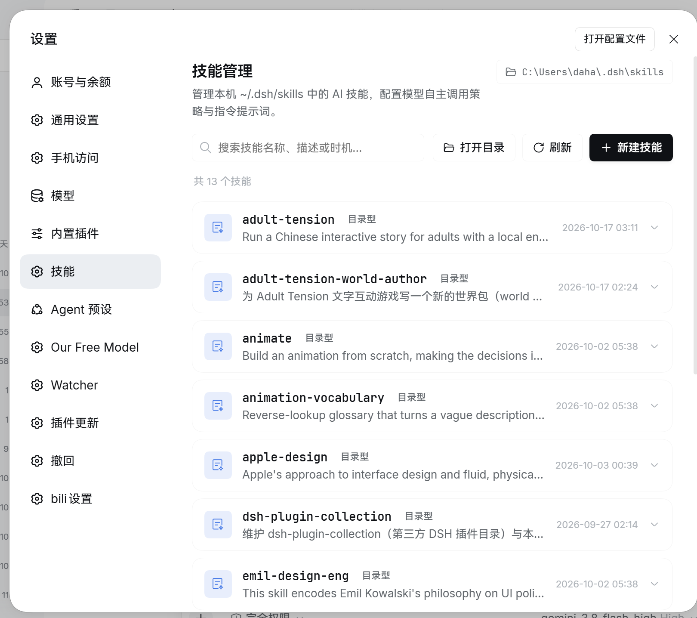
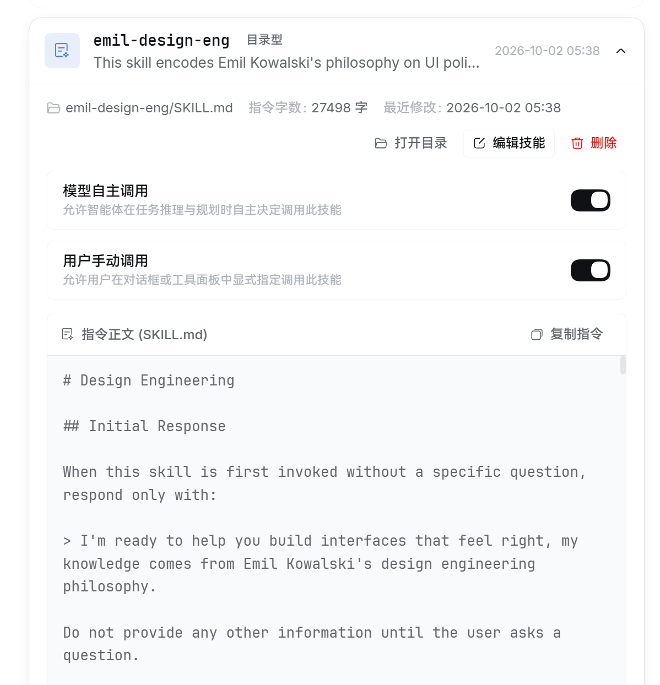

<div align="center">

# 🧩 dsh-skills-manager · Skills Manager

**Visual Skills Management for DeepSeek Harness: Inspect, Create, Edit Online, and Fine-Tune Invocation Policies with Native UI**

[](https://github.com/daha1216/dsh-skills-manager/releases)
[](./LICENSE)
[](https://github.com/topics/dsh-plugin)
[](https://github.com/daha1216/dsh-skills-manager)

[中文](./README.md) · **English**

</div>

---

In DeepSeek Harness (DSH), **Skills** are vital assets that provide agents with specialized domain knowledge, operational guidelines, and tool workflows. However, managing them has traditionally involved several friction points:
- Struggling to navigate nested folders in your OS terminal or file manager just to check installed skills?
- Needing to manually tweak YAML frontmatter indentation (`disable-model-invocation: true`) to prevent an agent from invoking a token-heavy skill autonomously?
- Wishing you could set specific skills to "Manual User Invocation Only" via an intuitive switch?
- Wanting to inspect a skill's full prompt instructions or quickly copy its markdown without opening an external text editor?

**dsh-skills-manager** introduces a **first-class, native "Skills" management panel** directly into DSH Settings. It empowers you to inspect, organize, configure, and edit your local AI skills through an elegant, reliable visual interface.

---

## 📸 Real-World Experience

<div align="center">

| Settings Overview & List | Skill Card Detail & Policy Controls |
| :---: | :---: |
|  |  |
| *Native "Skills" section in Settings: overview of all local skills, character counts, layouts, and modification times* | *Independent switches for "Model Invocation" and "User Invocation", instant prompt preview, and one-click copy* |

</div>

---

## ✨ Key Features

### 1. 🔍 Comprehensive Skill Overview & Instant Search
- **Dual global-root scanning**: Covers both `~/.dsh/skills` and `~/.agents/skills` (honoring `$DSH_HOME` / `$DSH_AGENTS_HOME` and the official provider's symlink/junction semantics).
- **Directory switcher**: Each root is listed and created in independently; a header tab switches between them, and every edit, delete, or policy change carries its root key so operations never cross roots.
- **Dual layout support**: Seamlessly handles both `<name>/SKILL.md` (bundle layout) and `<name>.md` (flat layout).
- **Rich metadata at a glance**: Displays skill validity status, layout badges, instruction character count (ideal for token budgeting), and last modified timestamp.
- **Fuzzy instant search**: Filter skills in real-time by **name**, **description**, or **trigger scenario (`whenToUse`)**.

### 2. 🎛️ Visual & Non-Destructive Policy Toggling
Every skill card features standalone policy switches:
- **Autonomous Model Invocation**: Controls whether the agent may autonomously select and invoke this skill during task planning (writes `disable-model-invocation: true` when disabled).
- **User Manual Invocation**: Controls whether users can explicitly call this skill via `@` or the tool picker in chat (writes `user-invocable`).
- **Lossless YAML preservation**: Updates only the targeted policy fields. **Comments, custom frontmatter keys, CRLF line endings, and multiline block scalars remain 100% intact**.

### 3. 📝 Live Instruction Preview, Copy & Quick Editing
- **Monospace source preview**: Expand any card to read the raw `SKILL.md` instructions with line breaks preserved, complete with a "Copy Prompt" button.
- **Built-in lightweight editor**: Create or modify skills directly in the browser; supports `Ctrl/Cmd + S` to save and `Esc` to cancel.
- **Safe editing guards**: Built-in optimistic concurrency checking (`expectedMtimeMs`) and unsaved changes confirmation dialogs; reloading or closing the tab while editing also triggers the browser's leave confirmation.
- **Damaged-file repair**: A `SKILL.md` with a leading BOM, missing frontmatter, or duplicate keys is marked as needing repair; saving keeps its body text and rebuilds valid frontmatter instead of discarding content.

### 4. 📁 Seamless OS File Manager Integration
- **Open root folder**: One-click toolbar action to launch your native file manager (Windows Explorer, macOS Finder, Linux xdg-open) targeting the skills root.
- **Open skill bundle**: Quickly open a specific skill's directory to inspect or add companion scripts, templates, and assets.
- **Copy root path**: The header shows the active skills root; click it to copy the full path.

### 5. 🛡️ Production-Grade Safety Architecture
- **Safe soft-deletion (.trash)**: Deleting a skill moves it into `<root>/.trash/` instead of executing a permanent deletion, preventing accidental work loss.
- **Automatic pre-write backups**: Every save creates a timestamped copy in `<root>/.backups/`.
- **Strict trust fence**: REST APIs enforce loopback / trusted host checks, strict same-origin headers, bounded request bodies, and path traversal guards.
- **Precise identity for duplicate names**: APIs address a skill by its relative file path, so editing, deleting, or toggling a policy only affects the card the user opened even when two skills declare the same name.
- **Name and collision guards**: Windows device names (`con`, `nul`, `com1`, …) and names longer than 64 characters are rejected; a directory differing only in case is never reused, so existing skills cannot be overwritten.
- **Bounded history**: `.backups` keeps the newest 200 snapshots and `.trash` the newest 100 entries, so long-term use does not grow without limit.
- **Retention boundary**: `.backups` and `.trash` are plaintext copies on disk; sensitive content from earlier versions or deleted skills remains readable. Clean those folders manually for skills that hold secrets.
- **Connection authorization**: When the host exposes its `connection` service, requests rejected by host admission get 401; without that service the loopback Host fence still applies.
- **Link-escape protection**: Listing follows symlinks like the official provider, but reads, writes, policy changes, and deletes first resolve `realpath` and refuse any target outside the skill root.
- **Request bounds**: JSON bodies are capped at 1 MB, a single skill file at 2 MB; names are capped at 64 characters and Windows device names / path fragments are rejected.

### 6. 🎨 First-Class Dark Theme & Bilingual Support
- Strictly aligned with DSH design guidelines and official Design Tokens.
- **v0.3.1 Theme overhaul**: High contrast switch knobs (18:1 ratio), accessible button palettes, and refined shadow tokens under dark mode.
- **Adaptive localization**: Automatically switches between English and Simplified Chinese according to DSH system settings.

---

## 📦 Installation & Upgrades

> **Prerequisite**: A DeepSeek Harness environment with the `dsh` CLI available.

### Method 1: Install via Profile (Recommended, via GitHub)

Run the following command in your terminal:

```bash
# For DSH Desktop
dsh plugin --profile desktop add github:daha1216/dsh-skills-manager

# For standalone Web deployments
dsh plugin --profile web add github:daha1216/dsh-skills-manager
```

> 💡 **Important**: After installing or updating, **completely quit and restart DSH Desktop** (or restart the `dsh` process and refresh your browser). The host process does not hot-reload newly injected profile bundles while running.
>
> To update in the future, simply re-run the same `add` command.
>
> **Compatibility**: `engines.dsh` declares `^0.2.0-rc.1`, i.e. **DSH 0.2.0-rc.1 up to (but not including) 0.3.0**. On an unsupported runtime the plugin manager refuses with `incompatible-version`; add a one-off exemption with `dsh plugin allow-version` if you really need to try it elsewhere. Once DSH reaches 0.3.x this plugin needs a new release to widen the range.

### Method 2: Local Development Link

```bash
git clone https://github.com/daha1216/dsh-skills-manager.git "D:/dsh work/skills-manager"
dsh plugin --profile desktop add link:"D:/dsh work/skills-manager"
```

---

## 🚀 Usage Guide

1. Open DeepSeek Harness and navigate to **Settings** (gear icon in the bottom left).
2. Click **Skills** in the left sidebar to open the management panel.
3. **Filter and browse**: Use the search input to filter skills by keyword or trigger scenario.
4. **Configure policies**: Expand any card and flip the switches for autonomous or user invocation. Changes persist immediately.
5. **Create a skill**: Click "+ New Skill", enter a kebab-case name, description, and your prompt instructions.

---

## 📁 Skill Directory & Format Specification

Skills reside in `~/.dsh/skills` (or `$DSH_HOME/skills`) and `~/.agents/skills` (`$DSH_AGENTS_HOME`); the panel manages both global roots.

Supported structures:
- **Bundle layout (Recommended)**: `<name>/SKILL.md` (can include adjacent assets and scripts).
- **Flat layout**: `<name>.md` (for single-file prompt definitions).

Standard `SKILL.md` format:

```yaml
---
name: my-skill
description: Clear, concise summary of what this skill accomplishes
whenToUse: Trigger condition (optional, e.g., when the user asks for financial reports)
disable-model-invocation: false   # Set true to prevent autonomous model calls
user-invocable: true             # Set true to allow explicit user calls
---

# Skill Instructions

Detailed markdown prompts, execution rules, and few-shot examples...
```

---

## 🔌 HTTP API

The host backend (`index.js`) exposes these trusted RESTful endpoints:

| Method | Path | Description |
| :--- | :--- | :--- |
| `GET` | `/skills-manager/api` | Enumerate all skills with metadata, policies, and mtime |
| `GET` | `/skills-manager/api/get?root=…&file=…` | Retrieve full skill source for editing (prefer `root` + relative file path; `name` still works, but duplicate names require `file`) |
| `POST` | `/skills-manager/api/save` | Create / edit / rename with optimistic concurrency and lossless YAML; pass `originalFile` to address the edited file exactly |
| `POST` | `/skills-manager/api/policy` | Toggle `disable-model-invocation` and `user-invocable` (accepts `name` or `file`) |
| `POST` | `/skills-manager/api/open` | Launch the OS file manager for root or a specific skill bundle (accepts `name` or `file`) |
| `POST` | `/skills-manager/api/delete` | Move a skill safely to `<root>/.trash/` (accepts `name` or `file`) |

> Every endpoint accepts `root` (`dsh` or `agents`, default `dsh`). Name-only legacy clients still hit the first match on duplicates; this panel always sends `root` + `file`.

---

## 🧪 Automated Tests

The repository includes a comprehensive test suite based on the Node.js native test runner:

```bash
node --test "test/*.test.mjs"
```

Covers 43 tests, including frontmatter round-trip fidelity (block scalars, quoted keys, comments, CRLF, unclosed and duplicate-key repair), dual-root isolation, BOM / missing-frontmatter data-loss regressions, file-addressed duplicate names, case-insensitive collision refusal, host connection admission (401), junction escape refusal, bounded history, and shell path sanitization.

---

## 📝 Changelog Highlights

### v0.3.4 (2026-10-27)
- **Data-safety hardening**: Fixed body loss when saving BOM / missing-frontmatter files, `/save` without `body` deleting instructions, duplicate-name skills being edited or deleted by the wrong file, and case-only directory takeover; APIs now address skills by `root` + `file`.
- **YAML fidelity**: Quoted keys, multi-line quoted scalars, block scalars, comments, duplicate keys, and legacy policy keys are understood semantically; untouched values keep their exact bytes, ambiguous values are quoted, and non-string / unterminated values are flagged for repair.
- **Security boundaries**: Host `connection` admission (401), `realpath` escape refusal, loopback Host fence, reserved/over-long name rejection, bounded history directories.
- **Dual global roots**: Manages `~/.dsh/skills` and `~/.agents/skills` with a directory switcher.
- Test suite grew to 43 tests.

### v0.3.1 (2026-10-18)
- **Dark mode token revamp**: Replaced mismatched tokens with official DSH tokens (`--dsw-alias-button-primary-fill`, `--dsw-alias-label-primary-foreground`, etc.), resolving illegible white-on-white text and fuzzy contrast in dark mode.
- **High-contrast components**: Reconstructed switch styles with 18:1 knob contrast and switched card shadows to `--dsw-shadow-lv2`.

### v0.3.0
- Added one-click actions to open skill root and bundle folders in OS file manager.
- Introduced prompt character counts and improved the raw-source preview typography.
- Added soft-deletion into `.trash/` and automatic pre-write backups into `.backups/`.

---

## 🙏 Contributors

Thanks to everyone who contributed code and improvements to this project:

- [@lanslot4n93r](https://github.com/lanslot4n93r) — dark-mode primary button color fix (`label-primary-inverted`), and packaging `cordis.patch.yml` so GitHub installs no longer miss the overlay.

---

## 📄 License

Distributed under the [MIT License](./LICENSE).
